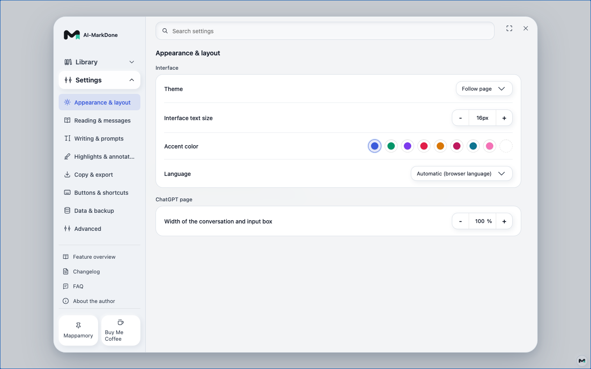

<div align="center">
  
  <h1>AI-MarkDone</h1>
  <p>Read, annotate and keep useful ChatGPT replies.</p>
  <p>
    <a href="https://chromewebstore.google.com/detail/ai-markdone/bmdhdihdbhjbkfaaainidcjbgidkbeoh"></a>
    <a href="https://addons.mozilla.org/firefox/addon/ai-markdone/"></a>
  </p>
  <p><a href="https://zhaoliangbin42.github.io/ai-markdone/en/">Website</a> · <a href="https://zhaoliangbin42.github.io/ai-markdone/en/manual/">Documentation</a> · <a href="./RELEASE_NOTES.md">Release notes</a> · <a href="https://github.com/zhaoliangbin42/AI-MarkDone/issues">Report a bug</a> · <a href="./README.zh.md">中文</a></p>
  <p>
    <a href="./LICENSE"></a>
    <a href="https://github.com/zhaoliangbin42/AI-MarkDone/stargazers"></a>
  </p>
</div>

AI-MarkDone is a free, open-source browser extension for ChatGPT. Read long replies, copy formulas and code, mark important passages, and save or export useful content. Hide or pin controls to suit the way you work.

[Install](#install) · [Highlights](#highlights) · [Getting started](#getting-started) · [FAQ](#faq) · [Changelog](#changelog) · [Development](#development) · [Support](#support)

## Install

| Browser | Download |
| --- | --- |
| Chrome | [Chrome Web Store][chrome-store] |
| Firefox | [Firefox Add-ons][firefox-store] |

Refresh ChatGPT after installation. Chrome and Firefox are supported.

## Highlights

<p align="center">
  <a href="./imgs/readme/reader.en.png"></a>
  <br><sub>Reader with sample content. Click the image for the full view.</sub>
</p>

| Feature | What you can do |
| --- | --- |
| [Message directory](https://zhaoliangbin42.github.io/ai-markdone/en/manual/message-navigation/) | Find replies by question, preview them on hover and move between messages. |
| [Reader](https://zhaoliangbin42.github.io/ai-markdone/en/manual/reader/) | Read long answers, tables, code and formulas, jump by heading, or use a separate tab. |
| [Markdown copy](https://zhaoliangbin42.github.io/ai-markdone/en/manual/partial-copy/) | Copy a reply or selection with its Markdown structure; partial code selections keep just the selected text. |
| [Formula tools](https://zhaoliangbin42.github.io/ai-markdone/en/manual/formulas/) | Click to copy LaTeX, preview formulas while typing, save PNG/SVG images or copy MathML. |
| [Annotations and highlights](https://zhaoliangbin42.github.io/ai-markdone/en/manual/annotations/) | Write beside the original passage, mark important text and turn your notes into a follow-up question. |
| [Bookmarks and Library](https://zhaoliangbin42.github.io/ai-markdone/en/manual/bookmarks/) | Keep conversation links or questions and replies; organize them with folders, search and batch actions. |
| [Message exports](https://zhaoliangbin42.github.io/ai-markdone/en/manual/export/) | Save selected replies as Markdown, PDF, PNG or an offline Markdown ZIP with image attachments. |
| [Prompts and settings](https://zhaoliangbin42.github.io/ai-markdone/en/manual/settings/) | Reuse prompts and adjust input behavior, controls, fonts, themes and accents; back up Library manually. |

<details>
<summary>See Settings</summary>

<p align="center"><a href="./imgs/readme/settings.en.png"></a></p>

</details>

Feature overview inside the extension lists all entry points and shortcuts. The [documentation][manual] covers the steps.

## Getting started

1. **Work with a reply:** open its toolbar to copy Markdown, save a bookmark, enter Reader or export messages.
2. **Mark what matters:** select a passage to annotate or highlight it; click a formula to copy LaTeX. Insert notes into the input box, review them, then send the follow-up yourself.
3. **Organize and adjust:** open Library and Settings from the lower-right AI-MarkDone icon or the browser extension icon. New installations show the directory by default; existing settings are preserved.

Selected Markdown: use `Cmd/Ctrl + Shift + C` on the ChatGPT page, or `Cmd/Ctrl + C` inside Reader. With Input enhancement enabled, Enter inserts a new line and `Cmd/Ctrl + Enter` sends.

## FAQ

<details>
<summary>Are annotations and highlights saved?</summary>

- Bookmarks and highlights save in the current browser; message bookmarks may save excerpts according to your settings.
- Save new annotations is off by default. While off, new annotations stay on the page; while on, new annotations survive refreshes. Previously saved annotations are unaffected.
- Annotations submit only when you choose Save. Clicking outside keeps the window open; closing it or refreshing discards unsaved edits.
- The Excerpt tray is temporary and clears on refresh.

Library backups include saved bookmarks, highlights, annotations and their folders. Prompts, settings and drafts are excluded. Export preferences separately as a settings file. [Google Drive backup](https://zhaoliangbin42.github.io/ai-markdone/en/manual/google-drive-backup/) is manual, not automatic synchronization.

</details>

<details>
<summary>Can every chart and card be saved offline?</summary>

Only supported blocks can be preserved; unavailable parts keep a text explanation. Offline Markdown ZIP keeps available images with the text. PDF and PNG offer static images or placeholders. Offline files do not retain interactive controls.

PDF uses the browser print dialog. PNG combines selected replies into one long image when possible, splitting oversized content into a ZIP of images.

</details>

<details>
<summary>Controls are missing after an update, or Separate reader has old content?</summary>

Reload the extension and refresh ChatGPT after updating. Keep the source ChatGPT tab open for Separate reader, and refresh its content manually when needed.

The directory adds replies as the website loads them; unavailable history may not be included. See the [FAQ][faq] or [report an issue][issues] for help.

</details>

## Changelog

### 6.2.5

Version 6.2.5 release notes and changelog are ready below. See the [source tag](https://github.com/zhaoliangbin42/AI-MarkDone/tree/v6.2.5); release downloads and store availability follow separately.

- Adjust conversation and input width from 50% to 500% in 25% steps.
- Customize common keyboard shortcuts and control automatic backslash suggestions independently.
- Fix highlight recoloring, improve mixed selections and open bookmarked messages more reliably.
- Keep new replies available to the directory, bookmarks, Reader and exports, and simplify everyday windows.

[Release notes](./RELEASE_NOTES.md) · [Full changelog](./CHANGELOG.md)

## Development

```bash
npm install
npm run dev
npm run test:smoke
npm run test:core
npm run build
```

Build output: `dist-chrome/` and `dist-firefox/`. Read [AGENTS.md](./AGENTS.md) for development rules and [docs/README.md](./docs/README.md) for architecture, feature contracts and test records.

<details>
<summary>Load a development build</summary>

Chrome: open `chrome://extensions/`, enable Developer mode, choose Load unpacked and select `dist-chrome/`. You can also extract an available Chrome package from [Releases][releases] and load it manually.

Firefox: open `about:debugging#/runtime/this-firefox` and temporarily load `dist-firefox/manifest.json`. [Temporary add-ons are removed on restart](https://extensionworkshop.com/documentation/develop/temporary-installation-in-firefox/); use the store version for everyday installation.

</details>

[Issues][issues] and pull requests are welcome. Include your browser, extension version and reproduction steps when reporting a problem.

## Support

I use ChatGPT often for reading and writing. This started as a way to make formulas easier to copy and long replies easier to read. Annotations, bookmarks and exports followed, with feedback helping me improve the details.

If the extension has helped you, a Star, a recommendation to a friend or a coffee helps support continued development.

<details>
<summary>Buy me a coffee</summary>

<table>
  <tr><th>Buy Me a Coffee</th><th>WeChat</th></tr>
  <tr><td></td><td></td></tr>
</table>

</details>

Thanks to everyone who reports issues, shares suggestions or contributes code, and to the open-source projects used here.

[MIT License](./LICENSE) · [Privacy](https://zhaoliangbin42.github.io/ai-markdone/en/privacy/) · [Email](mailto:zhaoliangbin42@gmail.com)

[chrome-store]: https://chromewebstore.google.com/detail/ai-markdone/bmdhdihdbhjbkfaaainidcjbgidkbeoh
[firefox-store]: https://addons.mozilla.org/firefox/addon/ai-markdone/
[manual]: https://zhaoliangbin42.github.io/ai-markdone/en/manual/
[faq]: https://zhaoliangbin42.github.io/ai-markdone/en/faq/
[issues]: https://github.com/zhaoliangbin42/AI-MarkDone/issues
[releases]: https://github.com/zhaoliangbin42/AI-MarkDone/releases
