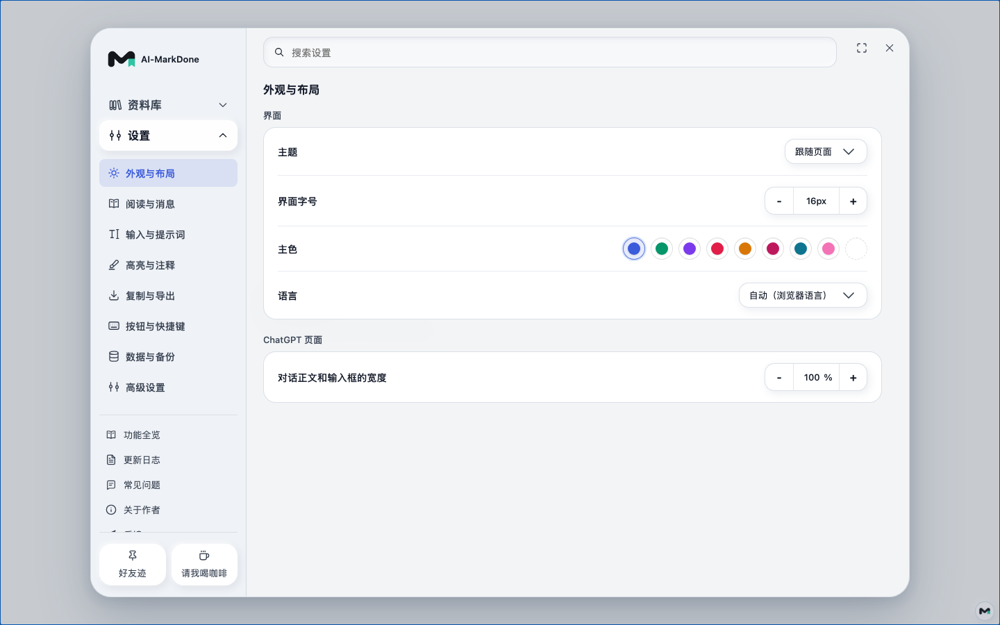

<div align="center">
  
  <h1>AI-MarkDone</h1>
  <p>让 ChatGPT 的内容更好读，也更方便整理。</p>
  <p>
    <a href="https://chromewebstore.google.com/detail/ai-markdone/bmdhdihdbhjbkfaaainidcjbgidkbeoh"></a>
    <a href="https://addons.mozilla.org/firefox/addon/ai-markdone/"></a>
  </p>
  <p><a href="https://zhaoliangbin42.github.io/ai-markdone/">官网</a> · <a href="https://zhaoliangbin42.github.io/ai-markdone/manual/">使用文档</a> · <a href="./RELEASE_NOTES.md">更新说明</a> · <a href="https://github.com/zhaoliangbin42/AI-MarkDone/issues">问题反馈</a> · <a href="./README.md">English</a></p>
  <p>
    <a href="./LICENSE"></a>
    <a href="https://github.com/zhaoliangbin42/AI-MarkDone/stargazers"></a>
  </p>
</div>

AI-MarkDone 是一个免费、开源的 ChatGPT 浏览器扩展，用来阅读长回复、复制公式与代码、标记重点，以及保存和导出有用的内容。常用按钮可以按自己的习惯隐藏或固定。

[安装](#安装) · [功能亮点](#功能亮点) · [快速开始](#快速开始) · [常见问题](#常见问题) · [更新日志](#更新日志) · [开发与贡献](#开发与贡献) · [支持项目](#支持项目)

## 安装

| 浏览器 | 下载 |
| --- | --- |
| Chrome | [Chrome Web Store][chrome-store] |
| Firefox | [Firefox Add-ons][firefox-store] |

安装后刷新 ChatGPT 页面即可使用。支持 Chrome 和 Firefox。

## 功能亮点

<p align="center">
  <a href="./imgs/readme/reader.zh.png"></a>
  <br><sub>阅读器演示，使用示例内容。点击图片可查看原图。</sub>
</p>

| 功能 | 能做什么 |
| --- | --- |
| [消息目录](https://zhaoliangbin42.github.io/ai-markdone/manual/message-navigation/) | 按提问查找回复，悬停预览，切换上一条、下一条消息。 |
| [阅读器](https://zhaoliangbin42.github.io/ai-markdone/manual/reader/) | 阅读长文、表格、代码和公式，用标题大纲跳转，也可以在独立标签页阅读。 |
| [Markdown 复制](https://zhaoliangbin42.github.io/ai-markdone/manual/partial-copy/) | 复制整条回复或选中的片段，保留对应的 Markdown 结构；部分代码选区只复制所选内容。 |
| [公式工具](https://zhaoliangbin42.github.io/ai-markdone/manual/formulas/) | 点击复制 LaTeX，输入时预览公式；可保存 PNG、SVG 图片，也可复制 MathML。 |
| [注释与高亮](https://zhaoliangbin42.github.io/ai-markdone/manual/annotations/) | 对着原文写意见、标记重点，再把原文和注释整理成下一轮提问。 |
| [书签与资料库](https://zhaoliangbin42.github.io/ai-markdone/manual/bookmarks/) | 保存对话链接或提问和回复，用文件夹、搜索和批量操作整理内容。 |
| [消息导出](https://zhaoliangbin42.github.io/ai-markdone/manual/export/) | 选择回复导出 Markdown、PDF、PNG，或带图片附件的离线 Markdown ZIP。 |
| [提示词、按钮与设置](https://zhaoliangbin42.github.io/ai-markdone/manual/settings/) | 复用提示词，调整输入方式、按钮、字号、主题和主色；资料库可手动备份。 |

<details>
<summary>查看设置界面</summary>

<p align="center"><a href="./imgs/readme/settings.zh.png"></a></p>

</details>

完整入口和快捷键可以在插件内的“功能全览”查看，具体步骤见[使用文档][manual]。

## 快速开始

1. **处理一条回复**：展开回复下方的工具栏，复制 Markdown、保存书签、打开阅读器或导出消息。
2. **边读边做标记**：选中文字添加注释或高亮；点击公式复制 LaTeX。注释可以整理进输入框，检查后再自行发送。
3. **管理与调整**：点击右下角 AI-MarkDone 图标，或浏览器扩展图标，打开资料库和设置。新安装默认显示消息目录，已有用户保留原来的设置。

选区 Markdown 复制：ChatGPT 原页面默认使用 `Cmd/Ctrl + Shift + C`，阅读器内使用 `Cmd/Ctrl + C`。开启输入增强后，Enter 换行，`Cmd/Ctrl + Enter` 发送。

## 常见问题

<details>
<summary>注释和高亮会保存吗？</summary>

- 书签和高亮保存到当前浏览器；消息书签可按设置只保存摘要。
- “保存新建的注释”默认关闭，关闭时新注释只留在当前页面；开启后新注释可在刷新后继续查看。已有保存的注释不受开关影响。
- 注释在点击“保存”后才会提交。点击框外不会关闭窗口；主动关闭或刷新页面会丢弃未保存的修改。
- 摘录区是当前页面的临时内容，刷新后清空。

资料库备份包含已保存的书签、高亮、注释及其文件夹，不包含提示词、设置或草稿。设置偏好可以单独导出；[Google Drive 备份](https://zhaoliangbin42.github.io/ai-markdone/manual/google-drive-backup/)是手动操作，不是自动同步。

</details>

<details>
<summary>图表和卡片都能离线保存吗？</summary>

目前只处理支持的图块，无法保存的部分会留下文字说明。离线 Markdown ZIP 会把可用图片和正文一起保存；PDF、PNG 可选择静态图片或文字占位，离线文件不保留网页交互。

PDF 通过浏览器打印窗口保存。PNG 尽量将所选回复合成一张长图，超出限制时拆图并打包 ZIP。

</details>

<details>
<summary>更新后按钮没出现，或者独立阅读器没有新内容？</summary>

更新插件后，重新加载扩展并刷新 ChatGPT 页面。独立阅读器需要保留原 ChatGPT 标签页，内容更新后可手动刷新。

消息目录会继续收录网站加载到的回复，尚未提供的历史不一定已包含。更多问题见[常见问题][faq]，也可以[提交 Issue][issues]。

</details>

## 更新日志

### 6.2.5

6.2.5 的发布说明和更新日志已整理在下方，源码见 [v6.2.5 标签](https://github.com/zhaoliangbin42/AI-MarkDone/tree/v6.2.5)。安装包分发与商店上架将另行进行。

- 对话正文和输入框宽度支持 50%～500%，以 25% 为步进调整。
- 支持自定义常用快捷键，反斜杠自动联想可独立开关。
- 修复高亮换色，增强混合内容选择，改善书签消息跳转。
- 让新回复及时进入目录、书签、阅读器和导出，并简化常用小窗口。

[本次更新说明](./RELEASE_NOTES.md) · [完整更新日志](./CHANGELOG.md)

## 开发与贡献

```bash
npm install
npm run dev
npm run test:smoke
npm run test:core
npm run build
```

构建输出：Chrome 为 `dist-chrome/`，Firefox 为 `dist-firefox/`。开发规范见 [AGENTS.md](./AGENTS.md)，架构、功能合同和测试记录见 [docs/README.md](./docs/README.md)。

<details>
<summary>手动加载开发版</summary>

Chrome：打开 `chrome://extensions/`，开启开发者模式，选择“加载已解压的扩展程序”，加载 `dist-chrome/`。也可从 [Releases][releases] 下载已发布的 Chrome 包并解压加载。

Firefox：打开 `about:debugging#/runtime/this-firefox`，临时载入 `dist-firefox/manifest.json`。[临时扩展在重启后失效](https://extensionworkshop.com/documentation/develop/temporary-installation-in-firefox/)，日常使用请从商店安装。

</details>

欢迎提交 [Issue][issues] 或 PR。反馈问题时，请附上浏览器、插件版本和操作步骤，方便复现。

## 支持项目

我自己经常用 ChatGPT 阅读和写作，最初只是想把公式复制顺、让长回复好读一点。后来慢慢加上了注释、书签和导出，也根据大家的反馈继续改进这些细节。

如果这个插件帮到了你，欢迎点个 Star、分享给需要的朋友，或者请我喝杯咖啡，支持后续更新。

<details>
<summary>请我喝杯咖啡</summary>

<table>
  <tr><th>Buy Me a Coffee</th><th>微信赞赏</th></tr>
  <tr><td></td><td></td></tr>
</table>

</details>

感谢所有反馈问题、提供建议和贡献代码的朋友，以及本项目使用的开源工具。

[MIT License](./LICENSE) · [隐私说明](https://zhaoliangbin42.github.io/ai-markdone/privacy/) · [邮件联系](mailto:zhaoliangbin42@gmail.com)

[chrome-store]: https://chromewebstore.google.com/detail/ai-markdone/bmdhdihdbhjbkfaaainidcjbgidkbeoh
[firefox-store]: https://addons.mozilla.org/firefox/addon/ai-markdone/
[manual]: https://zhaoliangbin42.github.io/ai-markdone/manual/
[faq]: https://zhaoliangbin42.github.io/ai-markdone/faq/
[issues]: https://github.com/zhaoliangbin42/AI-MarkDone/issues
[releases]: https://github.com/zhaoliangbin42/AI-MarkDone/releases
